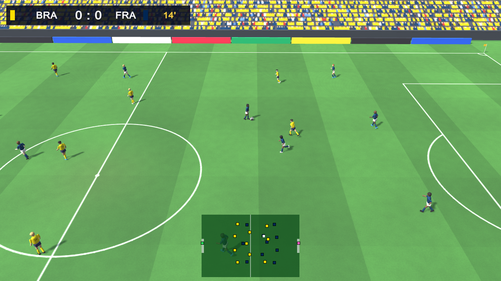
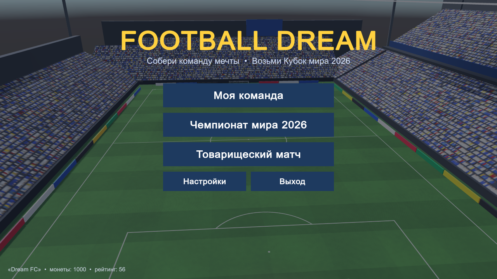
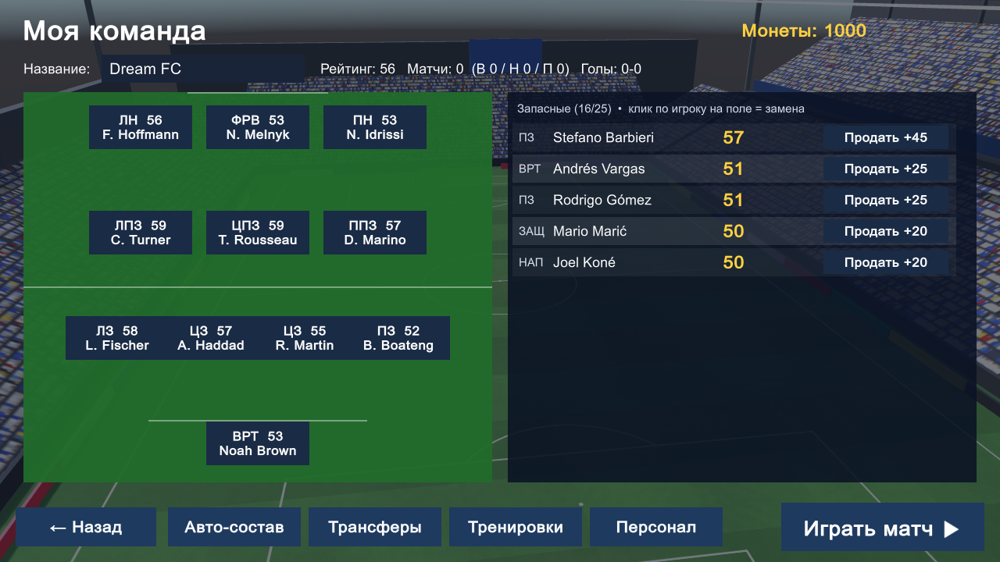
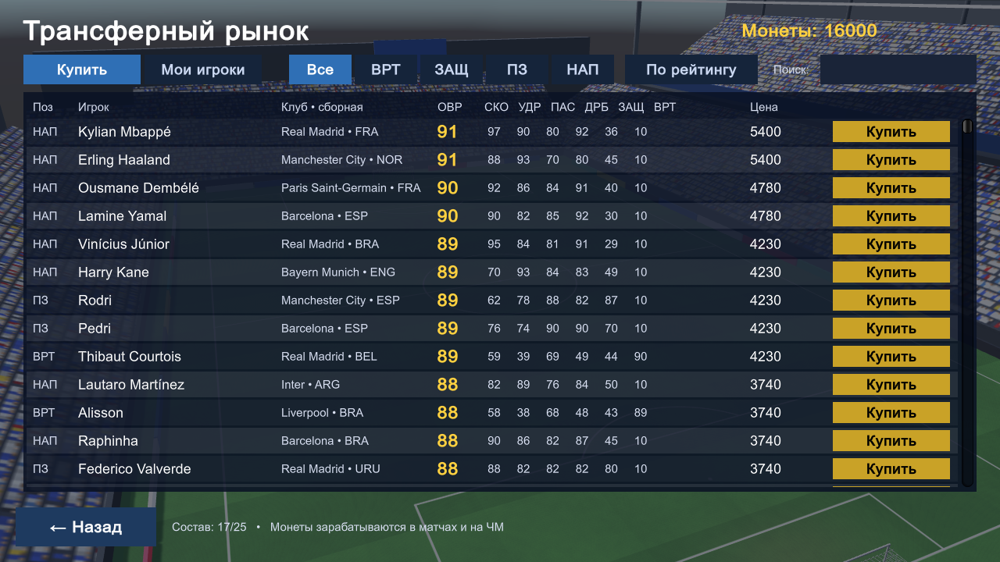
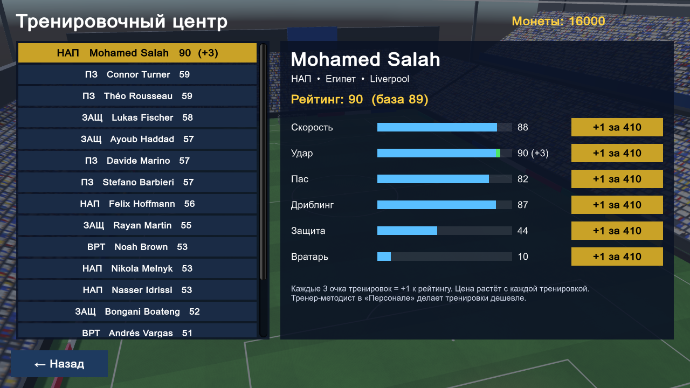
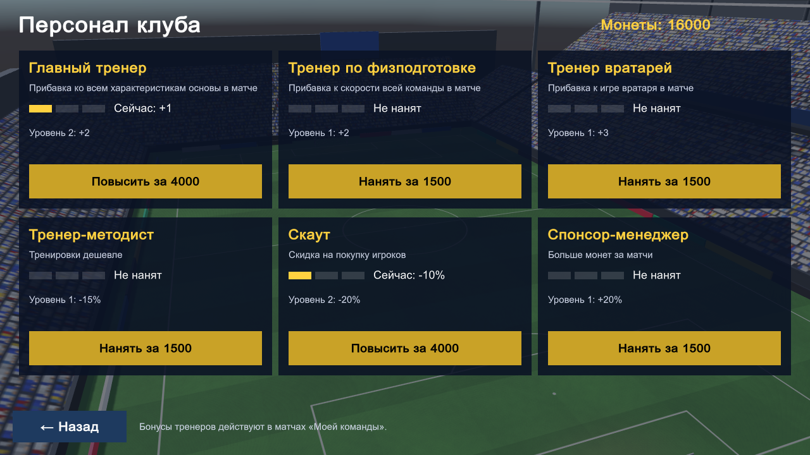
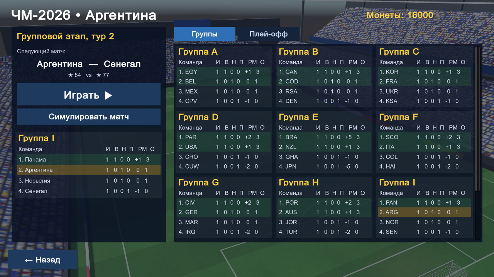
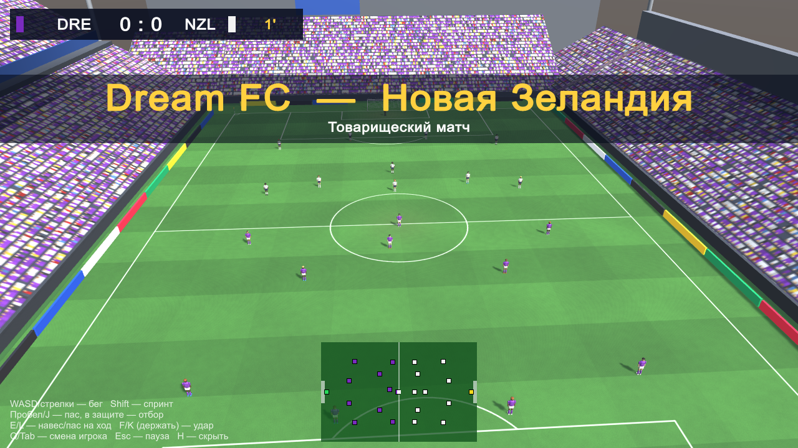
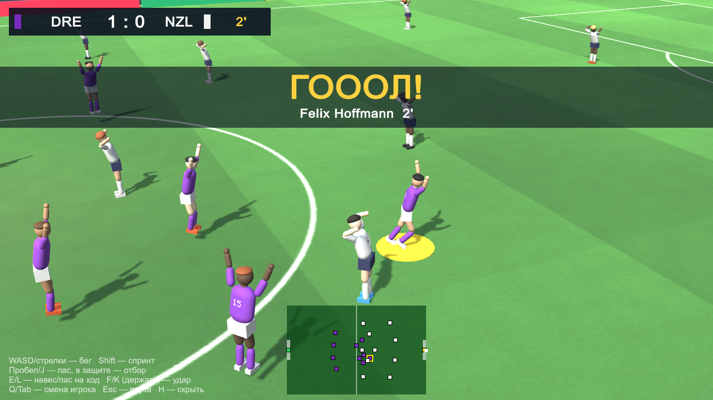

# Football Dream 2026

Футбольная игра на Unity в духе Dream League Soccer. Собираешь свою команду, покупаешь и тренируешь игроков, нанимаешь персонал и играешь сам. Есть отдельный режим — Чемпионат мира 2026 на 48 сборных.



## Режимы

- **Моя команда.** Старт с академией, дальше покупка реальных игроков на трансферном рынке, тренировки за монеты, найм тренеров и скаута, матчи против сборных за монеты.
- **Чемпионат мира 2026.** 48 сборных, 12 групп, в плей-офф выходят 2 лучших и 8 лучших третьих мест, потом сетка от 1/16 до финала с пенальти. Свои матчи играешь сам или симулируешь, остальные симулируются. За результат дают монеты для «Моей команды».
- **Товарищеский матч.** Любые две сборные, можно просто смотреть матч ИИ против ИИ.

## Скриншоты

| | |
|---|---|
|  |  |
| Главное меню | Состав «Моей команды» |
|  |  |
| Трансферный рынок с реальными игроками | Тренировочный центр |
|  |  |
| Найм персонала | ЧМ-2026: группы и следующий матч |
|  |  |
| Облёт стадиона перед матчем | Празднование гола |

Все скриншоты лежат в [docs/screenshots](docs/screenshots). Их можно переснять автотестом: `build.bat test`.

## Быстрый старт

Нужно:
- Windows 10/11;
- Unity **6000.0.77f1**, ставится через Unity Hub вместе с модулем Windows Build Support (Mono).

Если Unity стоит в другом месте, укажи путь:

```bat
set UNITY_PATH=D:\Unity\6000.0.77f1\Editor\Unity.exe
```

Сборка и запуск через [build.bat](build.bat) в корне проекта:

| Команда | Что делает |
|---|---|
| `build.bat` | собирает и запускает игру |
| `build.bat build` | только собирает в `Builds\Windows\FootballDream.exe` |
| `build.bat run` | запускает готовый билд, а если его нет — сначала собирает |
| `build.bat test` | прогоняет автотест и обновляет скриншоты в `docs\screenshots` |

Перед сборкой закрой редактор Unity с этим проектом: batch-режим не открывает проект, который уже открыт. Лог сборки пишется в `Logs\build.log`.

Запуск из редактора: открой папку проекта в Unity Hub, открой сцену `Assets/Scenes/Main.unity` и нажми Play. Ничего настраивать не нужно, игра собирает стадион, игроков и меню из кода.

## Управление

| Клавиши | Действие |
|---|---|
| WASD / стрелки | бег |
| Shift | спринт |
| Пробел / J | пас; в защите — отбор в ногах |
| E / L | навес, пас на ход |
| F / K (держать) | удар, сила зависит от того, сколько держишь; в защите — подкат |
| Q / Tab | смена игрока |
| Esc | пауза |
| H | скрыть подсказку |

Геймпад тоже работает: A — пас, B — удар, X — навес, RB — спринт, LB — смена игрока.

Направление удара задаётся стрелками в момент удара: вверх — дальний угол, вниз — ближний. Если передержать удар, мяч улетит выше ворот.

## Экономика «Моей команды»

- **Монеты** дают за матчи: победа, ничья, поражение плюс бонус за каждый гол. Чем сильнее соперник, тем больше награда. Ещё монеты дают за ЧМ: от 300 за вылет из группы до 6000 за титул.
- **Трансферы.** Цена зависит от рейтинга игрока. Продать можно за половину цены, игроков из основы продать нельзя. В заявке до 25 человек.
- **Тренировки.** +1 к выбранной характеристике за монеты, цена растёт с каждой тренировкой. Каждые 3 очка тренировок дают +1 к рейтингу.
- **Персонал.** 6 ролей по 3 уровня, найм стоит 1500 / 4000 / 9000:

| Роль | Эффект |
|---|---|
| Главный тренер | +1 / +2 / +3 ко всем характеристикам основы в матче |
| Тренер по физподготовке | +2 / +4 / +6 к скорости |
| Тренер вратарей | +3 / +6 / +9 к игре вратаря |
| Тренер-методист | тренировки дешевле на 15 / 30 / 45% |
| Скаут | скидка на трансферы 10 / 20 / 30% |
| Спонсор-менеджер | +20 / 40 / 60% монет за матчи |

Прогресс сохраняется автоматически в PlayerPrefs. Сбросить его можно в «Настройках», там же выбираются длительность матча (2–8 минут) и сложность.

## Структура проекта

```
Assets/
  Scripts/
    Core/        Game.cs — меню и режимы, Stadium.cs — стадион и эффекты, UI.cs, Sfx.cs, U.cs
    Data/        Database.cs — сборные и игроки, RealPlayers.cs — реальные составы,
                 SaveSystem.cs — карьера, тренировки, персонал, WorldCup.cs — турнир
    Match/       MatchManager.cs — правила, камера, HUD; FootballPlayer.cs — управление и ИИ;
                 PlayerRig.cs — модель и анимации; Ball.cs — физика мяча; MatchTypes.cs
  Editor/        ProjectTools.cs — создание сцены и сборка Windows-билда
  Resources/     базовые материалы (без них шейдеры вырезаются из билда и всё становится фиолетовым)
docs/screenshots/  скриншоты для README
build.bat          сборка, запуск, автотест
```

Вся графика собрана из примитивов и процедурных текстур, звуки тоже генерируются в коде. Внешних ассетов нет.

## Как править игроков и сборные

- **Составы** — в [Assets/Scripts/Data/RealPlayers.cs](Assets/Scripts/Data/RealPlayers.cs), по строке на игрока:
  ```
  "Имя|ПОЗ|ОВР|СКО УДР ПАС ДРБ ЗАЩ|Клуб"      полевой игрок, ПОЗ = DEF / MID / FWD
  "Имя|GK|ОВР||Клуб"                         вратарь
  ```
  Если в сборной меньше 18 игроков, заявку добивают сгенерированные запасные (клуб «Резерв»). Рейтинг сборной считается автоматически по её лучшей XI.
- **Список сборных, цвета формы и пулы имён** — в таблице в начале [Database.cs](Assets/Scripts/Data/Database.cs).
- **Цены и награды**: `Database.PriceFor`, `Game.Reward`, `WorldCup.Prize`.

## Автотест

`build.bat test` запускает билд с флагом `-autotest`. Он проходит по экранам, покупает и тренирует игрока, нанимает персонал, симулирует весь ЧМ и играет два ускоренных матча: ИИ против ИИ и в режиме игрока, с принудительным голом, чтобы проверить празднование. Результаты пишутся в `Builds\Windows\autotest.log`, скриншоты копируются в `docs\screenshots`. Сохранения игрока автотест не трогает.

## Важно

- Характеристики игроков — оценки по сезону 2025/26, это не официальные рейтинги EA. Клубы могут не учитывать трансферы лета 2026.
- Шесть участников из стыковых матчей (Италия, Турция, Украина, Дания, ДР Конго, Ирак) заданы по прогнозу. Поправь таблицу, если в реальности прошли другие.
- Жеребьёвка ЧМ упрощённая: 4 корзины по рейтингу, хозяева в группах A, B и D, без ограничений по конфедерациям.
- Реальные имена игроков годятся для личного проекта. Для публикации в сторах нужна лицензия (FIFPro и т. п.).
